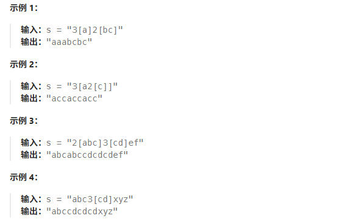

# 字符串解码笔记

## 题目解析

自行根据图中示例要求



## 解题策略

使用两个栈-->一个存数字，一个存字符

解题策略：  
1. 记录字符+数字
2. 遇到“]”后，处理完后直接压栈存储

```
import java.util.Stack;

class Solution {
    public String decodeString(String s) {
        Stack<Integer> numStack = new Stack<>();
        Stack<StringBuilder> strStack = new Stack<>();
        StringBuilder cur = new StringBuilder();
        int num = 0;

        for (char c : s.toCharArray()) {
            if (Character.isDigit(c)) {
                num = num * 10 + (c - '0');       // 处理多位数
            } else if (c == '[') {
                numStack.push(num);
                strStack.push(cur);
                num = 0;
                cur = new StringBuilder();        // 开新的一段
            } else if (c == ']') {
                int k = numStack.pop();
                StringBuilder temp = cur;
                cur = strStack.pop();
                for (int i = 0; i < k; i++) {
                    cur.append(temp);
                }
            } else {
                cur.append(c);                    // 普通字母
            }
        }
        return cur.toString();
    }
}
```